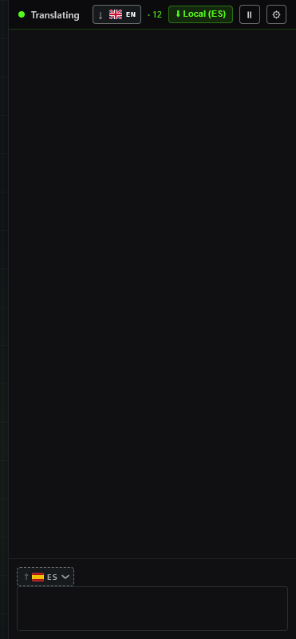
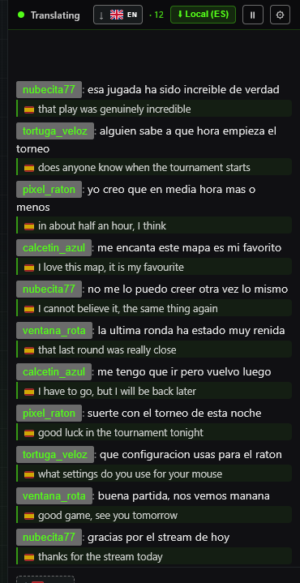
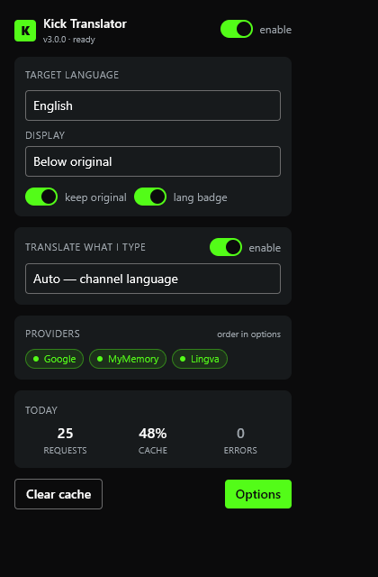
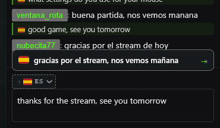
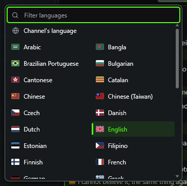

<div align="center">


# Kick Chat Translator

Leggi la chat di qualsiasi stream su Kick nella tua lingua e rispondi in quella del canale.<br>
Gratis, senza account, niente da configurare. 43 lingue, nella chat e nell'estensione stessa.

**[Aggiungi a Chrome, Brave o Edge](https://chromewebstore.google.com/detail/kick-chat-translator/nkkjmbkmacbdkboijmnhjnblcaiclhni)** &nbsp;·&nbsp; **[Aggiungi a Firefox](https://addons.mozilla.org/firefox/addon/kick-chat-translator/)**

[](https://chromewebstore.google.com/detail/kick-chat-translator/nkkjmbkmacbdkboijmnhjnblcaiclhni)
[](https://chromewebstore.google.com/detail/kick-chat-translator/nkkjmbkmacbdkboijmnhjnblcaiclhni)
[](https://addons.mozilla.org/firefox/addon/kick-chat-translator/)
[](https://github.com/Pkkls/kick-chat-translator/actions/workflows/ci.yml)
[](LICENSE)

[English](README.md) · [Français](README.fr.md) · [Español](README.es.md) · [Português (Portugal)](README.pt-PT.md) · [Português (Brasil)](README.pt-BR.md) · [Deutsch](README.de.md) · [Nederlands](README.nl.md) · [Polski](README.pl.md) · [Svenska](README.sv.md) · [Čeština](README.cs.md) · [Slovenčina](README.sk.md) · [Română](README.ro.md) · [Русский](README.ru.md) · [Українська](README.uk.md) · [Türkçe](README.tr.md) · [العربية](README.ar.md) · [עברית](README.he.md) · [日本語](README.ja.md) · [한국어](README.ko.md) · [简体中文](README.zh-CN.md) · [繁體中文](README.zh-TW.md) · [ไทย](README.th.md) · [Tiếng Việt](README.vi.md) · [Bahasa Indonesia](README.id.md) · [हिन्दी](README.hi.md) · [Suomi](README.fi.md) · [Norsk](README.no.md) · [Dansk](README.da.md) · [Ελληνικά](README.el.md) · [Magyar](README.hu.md) · [Български](README.bg.md) · [Català](README.ca.md) · [Slovenščina](README.sl.md) · [Eesti](README.et.md) · [Lietuvių](README.lt.md) · [Latviešu](README.lv.md) · [فارسی](README.fa.md) · [বাংলা](README.bn.md) · [தமிழ்](README.ta.md) · [Bahasa Melayu](README.ms.md) · [Filipino](README.tl.md) · [粵語](README.yue.md)



[Guardala su una chat vera](https://www.youtube.com/watch?v=NoGJeUrwy9o)

</div>

## Come funziona

1. Installala e apri un qualsiasi stream su Kick. Una barra verde in cima alla chat ti dice che è attiva.
2. Ogni messaggio riceve la sua traduzione subito sotto, appena arriva, nella lingua del tuo browser. Vale per
   le dirette e per i replay dei VOD.
3. Scrivi una risposta nella tua lingua. Un'anteprima sopra la casella della chat la mostra nella lingua del
   canale: premi Tab o cliccaci sopra, e quella versione prende il posto di quello che hai scritto.

La lingua del canale viene letta da Kick stesso, quindi non c'è niente da configurare. Entrambe le lingue si
possono cambiare nelle impostazioni, e la lingua di lettura si può ricordare canale per canale.

## Cosa offre

- **43 lingue**, comprese quelle che si scrivono da destra a sinistra (arabo, ebraico, persiano), con le
  varianti regionali tenute separate (portoghese brasiliano ed europeo, cinese semplificato e tradizionale, cantonese)
- **Anche l'estensione le parla**: impostazioni, popup e barra della chat in tutte e 43, da scegliere in un menu con le bandiere
- **Gratis fin da subito** con Google Translate. Aggiungi la tua chiave DeepL gratuita per tradurre meglio le
  lingue europee; MyMemory e Lingva subentrano quando un motore salta
- **Traduzione sul dispositivo** in Chrome e Edge dove il browser la mette a disposizione: 22 ms invece di 1,6 s, e
  il testo non lascia mai il tuo computer
- **Filtri**: ignora i bot, silenzia utenti o canali, nascondi le righe che contengono una parola, traduci solo
  le lingue che scegli
- **Pensata per le chat veloci**: le emote 7TV restano come sono, lo spam di emoji e i link vengono tolti prima
  di inviare qualsiasi cosa, un glossario per i nomi che i motori storpiano, una cache delle traduzioni
- **Quattro stili di visualizzazione**: sotto il messaggio, sulla stessa riga, al posto del messaggio, o solo al passaggio del mouse
- **Metti in pausa un canale** dalla barra della chat senza fermare gli altri. Cambiando canale o aggiornando
  l'estensione, le schede aperte continuano a tradurre, senza ricaricare
- Chrome, Brave, Edge e Firefox

| La chat, tradotta mentre scorre | Il popup della barra degli strumenti |
|---|---|
|  |  |

| Quello che scrivi, prima di inviarlo | Scegli una lingua, o lascia scegliere a lei |
|---|---|
|  |  |

<sub>Catturate dalla build pubblicata in una chat inventata da questo repository: i nomi utente e i messaggi
sono fittizi e le traduzioni vengono servite in locale, quindi nessun utente reale compare in questa pagina.</sub>

## Installazione

[Chrome, Brave, Edge: Chrome Web Store](https://chromewebstore.google.com/detail/kick-chat-translator/nkkjmbkmacbdkboijmnhjnblcaiclhni)
&nbsp;·&nbsp;
[Firefox: Mozilla Add-ons](https://addons.mozilla.org/firefox/addon/kick-chat-translator/)

Le copie degli store si aggiornano da sole.

<details>
<summary>Installazione manuale, da uno zip di release</summary>

Scarica lo zip per il tuo browser da [Releases](https://github.com/Pkkls/kick-chat-translator/releases/latest) e decomprimilo.

- Chrome, Brave, Edge (`…-chromium.zip`): apri `chrome://extensions`, attiva la Modalità sviluppatore, clicca su Carica estensione non pacchettizzata e scegli la cartella.
- Firefox 121+ (`…-firefox.zip`): apri `about:debugging#/runtime/this-firefox`, clicca su Carica componente aggiuntivo temporaneo e scegli `manifest.json`.

Se hai installato anche la versione dello store, disattivala prima, altrimenti ogni messaggio viene tradotto
due volte. Una copia installata così non si aggiorna da sola: la sua icona mostra un badge quando esce una
versione più recente, e il popup rimanda allo store.

</details>

## Motori di traduzione

Quattro provider in catena: quando uno fallisce, subentra il successivo. L'ordine lo decidi tu.

| Provider | Chiave | Nota |
|---|---|---|
| Google | nessuna | quello predefinito, funziona subito |
| DeepL | gratuita | la qualità migliore, [chiave gratuita](https://www.deepl.com/pro-api) per 1 milione di caratteri al mese |
| MyMemory | nessuna | di riserva |
| Lingva | nessuna | di riserva, su un'istanza pubblica a meno che tu non punti alla tua |

Il traduttore integrato di Chromium è più veloce di tutti. Misurato su un canale in diretta: 22 ms da quando
un messaggio appare a quando la sua traduzione è a schermo, contro 1618 ms con la catena nel cloud, senza rete
e senza quota. Chrome ed Edge 138 e successivi possono offrirlo, anche se non tutte le copie lo fanno, e ogni
coppia di lingue richiede di scaricare il suo modello una volta, con un clic dalla barra. Firefox non ce l'ha.
Dove manca, subentra la catena nel cloud e non si rompe niente.

## Impostazioni

Clicca sull'ingranaggio nella barra della chat, oppure clic destro sull'icona dell'estensione e scegli Opzioni.

- **Provider**: ordine dei motori, la tua chiave DeepL e la modalità: prima sul dispositivo, prima nel cloud,
  o solo sul dispositivo
- **Visualizzazione**: lingua di destinazione, stile di visualizzazione, testo originale ed etichetta della
  lingua, dimensione del testo, interlinea, carattere, colore principale, tema della chat, l'anteprima di
  scrittura e cosa succede quando ci clicchi
- **Filtri**: bot, utenti, canali, parole chiave, lingue di origine e un glossario di sostituzioni
- **Avanzate**: dimensione e durata della cache, richieste simultanee, limite per canale, backup e ripristino
- **Attività**: messaggi tradotti, risposte dalla cache, ogni lingua vista in chat, e perché ciascuna delle
  ultime 50 righe è stata tradotta o lasciata stare
- **Tastiera**: Alt+T attiva o disattiva la traduzione della chat, Alt+W l'anteprima di scrittura
- Il pulsante della lingua nella barra delle azioni della chat: un clic alterna tra la lingua del canale e la
  tua ultima scelta, tenerlo premuto apre l'elenco, digitare due lettere lo filtra

## Lingue supportate

Inglese · Francese · Spagnolo · Portoghese · Portoghese (Brasile) · Tedesco · Italiano · Olandese · Polacco · Svedese · Ceco · Slovacco · Rumeno · Russo · Ucraino · Turco · Arabo · Ebraico · Giapponese · Coreano · Cinese (semplificato) · Cinese (tradizionale) · Thailandese · Vietnamita · Indonesiano · Hindi · Finlandese · Norvegese · Danese · Greco · Ungherese · Bulgaro · Catalano · Sloveno · Estone · Lituano · Lettone · Persiano · Bengalese · Tamil · Malese · Filippino · Cantonese

La chat si traduce in ognuna di queste, e l'interfaccia dell'estensione è disponibile in tutte.

## Privacy

Nessun account, nessuna analitica, nessun server mio. I messaggi della chat vanno al provider di traduzione
che hai scelto e da nessun'altra parte, e in modalità sul dispositivo nemmeno lì. Una copia installata da uno
store non fa altre richieste. Una copia installata a mano chiede a GitHub l'ultimo tag di release, al massimo
ogni sei ore, per sapere se mostrare il badge di aggiornamento. [Dettagli](PRIVACY.md)

## Domande frequenti

**I messaggi non vengono tradotti.**
Apri la scheda Attività nelle impostazioni e premi "Leggi le decisioni": elenca le ultime 50 righe e dice perché
ognuna è stata tradotta o lasciata stare. La maggior parte delle righe saltate è saltata di proposito. In una
sessione in diretta, 213 su 234 erano lo stesso utente che si ripeteva, 9 erano troppo corte, 7 solo emoji o
risate, e 1 era già nella lingua di lettura. Se la scheda non mostra proprio niente, l'estensione non vede la
chat: apri una segnalazione.

**La barra verde è sparita.**
Ricarica la pagina. Se succede di nuovo, apri una [segnalazione](https://github.com/Pkkls/kick-chat-translator/issues)
con il canale e cosa avevi fatto prima.

**Come ottengo traduzioni migliori?**
Aggiungi una chiave DeepL gratuita nelle impostazioni. Il piano gratuito copre un milione di caratteri al mese,
e DeepL viene usato solo sulle coppie di lingue in cui batte i motori gratuiti.

**Quale stile di visualizzazione devo usare?**
Sotto il messaggio. Gli altri tre funzionano, ma li stiamo ancora rifinendo.

**Posso usare l'estensione nella mia lingua?**
Sì. Segue la lingua del tuo browser, e il menu in cima alle impostazioni la cambia in una qualsiasi delle 43.

**Funziona sui replay dei VOD?**
Sì, come sulle dirette.

**Ha smesso di funzionare dopo un aggiornamento di Kick.**
Kick ogni tanto cambia come è costruita la sua chat. Apri una [segnalazione](https://github.com/Pkkls/kick-chat-translator/issues)
e viene sistemata.

**È fatta da Kick?**
No. È un progetto indipendente e open source, senza alcun legame con Kick.

## Novità

Nella 3.2.0:

- Le impostazioni, il popup e la barra della chat parlano tutte le 43 lingue in cui l'estensione traduce, non 10, con ebraico e persiano da destra a sinistra come l'arabo
- Le dieci lingue che già parlava sono state riscritte perché suonino come scritte in quella lingua, non parola per parola dall'inglese
- Il menu della lingua dell'interfaccia mostra la bandiera di ogni lingua e si usa anche con la tastiera

Ogni versione, con cosa è cambiato e la misura che c'è dietro:
[Releases](https://github.com/Pkkls/kick-chat-translator/releases) e [CHANGELOG.md](CHANGELOG.md).

## Sviluppo

```bash
git clone https://github.com/Pkkls/kick-chat-translator.git
cd kick-chat-translator
npm ci
npm run release:check    # typecheck, lint, unit test, build: il controllo che ogni pacchetto deve superare
npm run build:firefox    # build per Firefox, nella stessa cartella dist/
npm run package:all      # i due zip, in release/
npm run dev              # HMR
```

Le build sono riproducibili: lo stesso commit produce zip identici byte per byte su qualsiasi macchina,
verificato costruendo un `git archive` del tag in una cartella vuota e confrontando gli hash.

Oltre agli unit test, 42 gate offline caricano l'estensione compilata in un browser vero, la usano e
verificano cosa fa, con la pagina servita in locale e il motore di traduzione che risponde in locale.
Richiedono Playwright, che di proposito non è una dipendenza: punta `UX_KIT` a una cartella il cui
`node_modules` lo contenga, oppure esegui `npm i -D playwright`.

```bash
node test/e2e/run-gates.mjs --headless                  # tutti e 42, senza finestra
node test/e2e/store-shots-fixture.mjs --lang=ja         # gli screenshot dello store, in una lingua della scheda
node test/e2e/store-shots-fixture.mjs --gif             # screenshot dello store in inglese, le immagini del README e questa GIF
```

Le stringhe dell'interfaccia stanno in `src/shared/i18n/` (popup e opzioni, indicizzate dal testo inglese) e
`src/content/i18n/` (barra della chat, indicizzate per id con il testo inglese come ripiego), un file per
lingua; i test richiedono a ogni file l'insieme completo delle chiavi. I testi degli store stanno in
[store/](store/), e una release è un tag di versione: la CI la costruisce, la verifica e la pubblica su
entrambi gli store.

Stack: Manifest V3, Vite, TypeScript, Preact, Tailwind.

## Progetti correlati

- [kick-ad-blocker](https://github.com/Pkkls/kick-ad-blocker), blocca le pubblicità pre-roll e in sovrimpressione di Kick
- [kick-core](https://github.com/Pkkls/kick-core), il client del gateway in tempo reale condiviso da queste estensioni
- [kickbus](https://github.com/Pkkls/kickbus), i webhook ufficiali di Kick inoltrati ai bot locali via SSE
- [kick-drops-miner](https://github.com/Pkkls/kick-drops-miner), app per Windows che fa avanzare il tempo di visione dei drop di Kick

## Licenza

MIT. Nessun legame con Kick.
